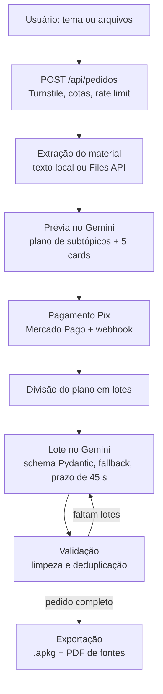

# Gerador de Flashcards com IA

Gera baralhos de flashcards para o Anki a partir de um tema ou de material de estudo (PDF, DOCX, TXT, imagens), usando o Google Gemini. Você vê uma prévia grátis, paga via Pix e baixa o arquivo `.apkg`.

**Site:** https://gerador-flashcards.vercel.app

<!-- Demonstração: vou adicionar a imagem em docs/demo.gif -->


---

## Funcionalidades

- **Geração por IA** a partir de um tema livre ou de até 5 arquivos (`.pdf`, `.docx`, `.txt`, `.md`, `.png`, `.jpg`, `.webp`).
- **Prévia gratuita:** antes de pagar, o usuário recebe o plano do baralho e os primeiros cards (5, por padrão).
- **Pagamento via Pix** (Mercado Pago), com webhook validado por assinatura. Em desenvolvimento há um provedor falso que simula aprovação e recusa sem dinheiro real.
- **Exportação:** baralho `.apkg` pronto para importar no Anki e um PDF com as fontes citadas pela IA.
- **Conversão de JSON para Anki:** o endpoint `POST /upload` recebe um JSON de cards (`{"nome_deck": ..., "cards": [{"pergunta", "resposta"}]}` ou uma lista simples) e devolve o `.apkg`.

## Como a IA é usada

A integração fica em [`app/ia/`](app/ia/): `gemini.py` (provedor), `geracao.py` (orquestração), `prompts.py` (prompts e schemas) e `material.py` (tratamento dos arquivos).

- **Google Gemini via SDK `google-genai`.** O provedor implementa uma interface (`app/ia/base.py`), então dá para trocar de LLM sem mexer na orquestração. Os modelos vêm da configuração: um modelo barato para a prévia e um intermediário para a geração paga.
- **Saída estruturada.** Cada chamada envia `response_mime_type="application/json"` e `response_schema` com um modelo Pydantic (`PlanoPrevia`, `LoteGerado`). A resposta é lida em `resposta.parsed` ou validada com `model_validate_json`. Não há extração de JSON por regex. Uma resposta fora do formato conta como erro temporário e é tentada de novo.
- **Modelo de fallback e retentativas.** `chamar_ia` alterna entre o modelo principal e o reserva (principal, reserva, principal, reserva), porque repetir de imediato um modelo sobrecarregado costuma falhar de novo. Erros 429/5xx e timeouts são temporários. Erros 4xx são permanentes e tiram o modelo da fila. As retentativas automáticas do SDK estão desligadas para que o controle de tempo fique com a aplicação.
- **Thinking budget.** Raciocínio desligado na prévia (`THINKING_PREVIA=0`) e limitado a 512 tokens nos lotes pagos (`THINKING_GERACAO`). Se um modelo recusar o orçamento com erro 400, a chamada é refeita sem ele e o modelo é lembrado para não pagar essa recusa de novo.
- **Geração em lotes com orçamento de tempo.** A prévia gera o plano: os subtópicos, cada um com uma quantidade de cards. O restante é dividido em lotes de até 40 cards, e o front-end pede um lote por requisição, para caber no limite de 60 s da função serverless da Vercel. Cada requisição tem um prazo de 45 s (`TEMPO_MAX_LOTE_S`). Cada tentativa recebe como timeout o tempo que sobra, menos uma reserva de 15 s para o modelo reserva, e nenhuma chamada começa com menos de 10 s restantes. Lotes que ficam incompletos são completados em até duas rodadas extras. O pedido só é entregue com pelo menos 90% dos cards; abaixo disso, o cliente escolhe entre reembolso total ou ficar com os cards gerados e receber um reembolso parcial.
- **Material do aluno e Files API.** O texto de PDF, DOCX e TXT é extraído no servidor e fatiado entre os lotes (cada lote recebe só a sua parte). Imagens e PDFs escaneados vão para a Files API do Gemini. O PDF escaneado é dividido em partes, uma por lote, para não reenviar o documento inteiro a cada chamada. Antes de qualquer envio, o tipo real de cada arquivo é conferido pela assinatura binária (magic bytes) e o número de páginas é limitado conforme o tamanho do pedido. Terminada a geração, os arquivos são apagados do provedor e o texto é apagado do banco.
- **Como evitar cards duplicados.** Os prompts pedem que cada card cubra um aspecto distinto, e o prompt de cada lote inclui as perguntas que já existem no baralho (até 200) com a instrução de não repeti-las nem reformulá-las. Na aplicação, cada pergunta é normalizada (minúsculas, sem acentos e sem pontuação) e descartada se o hash coincidir com o de outra ou se a sobreposição de palavras (Jaccard) for de 80% ou mais.
- **Registro de uso.** Toda chamada, com ou sem sucesso, grava modelo, tokens, latência e custo estimado na tabela `UsoIA`.

## Controle de custo e anti-abuso

Implementado em [`app/seguranca.py`](app/seguranca.py):

- **Limite de prévias:** 3 por dia por navegador (cookie assinado) e 15 por dia por IP. O IP é guardado apenas como HMAC, nunca em claro.
- **Teto diário de gasto:** o custo estimado das prévias do dia é somado a partir de `UsoIA`. Acima de US$ 0,50 (configurável), novas prévias são suspensas e a compra direta continua disponível. Modelos sem preço cadastrado são estimados pelo preço mais caro.
- **Cloudflare Turnstile:** o token é validado no servidor antes de gerar uma prévia. Se o serviço estiver fora do ar, a prévia é bloqueada.
- **Rate limit por IP:** contadores por minuto guardados no próprio banco, o que funciona em serverless sem Redis.
- **Cache de prévias:** o mesmo tema (sem arquivos) com a mesma quantidade de cards reaproveita uma prévia recente sem chamar a IA.
- **Outros:** limpeza diária de pedidos expirados via Cron da Vercel e cabeçalhos de segurança com CSP baseada em nonce.

## Arquitetura



Estrutura do código:

```
app/
  ia/            provedor Gemini, prompts/schemas, orquestração de lotes, tratamento de material
  pagamentos/    interface de provedor, Mercado Pago, provedor falso e serviço de pagamento
  exportacao/    .apkg (genanki) e PDF de fontes (reportlab)
  rotas/         páginas, API de pedidos, webhooks, tarefas agendadas, rotas de desenvolvimento
  models.py      modelos SQLAlchemy (pedido, card, lote, pagamento, uso de IA, cotas)
  seguranca.py   rate limit, Turnstile, cotas e orçamento
  config.py      configuração por variáveis de ambiente
api/index.py     entrada da função serverless na Vercel
migrations/      migrações Alembic
tests/           testes com pytest
```

## Stack

- **Back-end:** Python 3.12, Flask, SQLAlchemy 2, Alembic
- **Banco:** PostgreSQL em produção, SQLite em desenvolvimento
- **IA:** Google Gemini (`google-genai`), Pydantic
- **Arquivos:** genanki (`.apkg`), reportlab (PDF), pypdf, python-docx
- **Pagamento:** Mercado Pago (Pix)
- **Infra:** Vercel (serverless + Cron), Cloudflare Turnstile
- **Front-end:** HTML, CSS e JavaScript, sem framework

## Como rodar localmente

```bash
python -m venv venv
venv\Scripts\activate            # Linux/Mac: source venv/bin/activate
pip install -r requirements-dev.txt
cp .env.example .env             # preencha pelo menos GEMINI_API_KEY
python app.py                    # http://localhost:5000
```

Em desenvolvimento, a aplicação usa SQLite (`local.db`), aplica as migrações automaticamente e usa o provedor de pagamento falso. O passo a passo completo está em [COMO_RODAR_LOCAL.md](COMO_RODAR_LOCAL.md), e o deploy em [DEPLOY_VERCEL.md](DEPLOY_VERCEL.md).

## Testes

```bash
python -m pytest tests
```

Os testes não chamam a IA nem o Mercado Pago de verdade: usam provedores falsos e um banco SQLite temporário. Eles estão organizados pelas fases do [plano de implementação](PLANO_DE_IMPLEMENTACAO.md).

## Licença

Distribuído sob a licença MIT. Veja [LICENSE](LICENSE).
